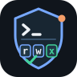

<p align="center">
  
</p>

# Bash Guard

<p align="center">
  
  
  
  
  
  
  
</p>

[中文说明](README.zh-CN.md) · [Security policy](https://github.com/lloydzhou/bash-agent/blob/main/docs/bash-tool-policy.md) · [Releases](https://github.com/lloydzhou/claude-bash-guard/releases) · [Homebrew Tap](https://github.com/lloydzhou/homebrew-tap)

> **Keep coding agents useful—without making every tool call a leap of faith.**

**Bash Guard is a local-first safety gate for Claude Code and Codex.** It intercepts `Bash`, `Read`, `Edit`, `Write`, `Glob`, and `Grep` before execution, then applies a Rust permission policy you can inspect and tune. Add a Jev API key to layer in a confidence-aware semantic decision; remove it and the original local policy continues unchanged.

## Why Bash Guard

- **Still enforced when permissions are bypassed.** The `PreToolUse` Hook runs before the supported client's permission decision.
- **Fail closed.** A missing binary, invalid Hook input, or audit-write failure denies the protected tool call instead of silently allowing it.
- **Permission-inspired least privilege.** The policy expresses sensitive capabilities with Linux-file-permission-inspired bits; grants must be explicit, and ungranted capabilities stay denied. It is an application policy model, not an operating-system file-permission implementation.
- **Jev when you want semantic judgment.** With a key, Jev classifies the exact operation into a `required` permission number (twelve calibrated probability questions, one per scope × bit). That number is compared with your configured mode through the same bit logic as the local policy, so the final allow/deny is always yours. Without a key—or when Jev is unavailable—Bash Guard uses the local policy. A mode of `7777` grants everything and skips both reviewers entirely.
- **Small operational footprint.** Registration creates a minimal local Claude Code plugin adapter; it records the binary path and never copies the binary.
- **Auditable by default.** JSONL audit records capture the client, tool name, each decision, operation summary, caller working directory, and policy requirement. Write content and Edit replacement text are recorded only as lengths.
- **Shared policy semantics.** Command classification uses the same Rust policy implementation and denial wording as Bash Agent.

## How a tool call is decided

```text
Agent tool call
      │
      ├── mode 7777 ─────────────────► allow (no review at all)
      │
      ├── no Jev key ────────────────► local policy required bits ──► bit compare ──► allow / deny
      │
      └── Jev key configured ───────► Jev 12-question required bits ─┐
                                       │                             ├─► same bit compare ──► allow / deny
                          API error ───┴──► local policy required ───┘
```

Both reviewers emit the same artifact—a four-digit `required` mode—and the final allow/deny always comes from one shared bit comparison against your configured mode.

## Quick start

### 1. Install

Homebrew:

```bash
brew tap lloydzhou/tap
brew install bash-guard
```

Or download the archive for your platform from [GitHub Releases](https://github.com/lloydzhou/claude-bash-guard/releases).

### 2. Register with Claude Code

```bash
bash-guard claude register --scope user
```

Scopes are `user`, `project`, and `local`; `user` is the default. Registration uses the official Claude Code plugin CLI to add a local Marketplace and install the adapter.

### 3. Check it

```bash
bash-guard claude status
bash-guard codex status --scope user
```

Start Claude Code or Codex normally. Bash Guard is invoked automatically for each `Bash`, `Read`, `Edit`, `Write`, `Glob`, and `Grep` tool call in the registered scope. `Read`, `Glob`, and `Grep` require read permission; `Edit` and `Write` require write permission; `Bash` keeps its existing command classification.

### Register with Codex

```bash
bash-guard codex register --scope user
# Or write to the current Git repository's .codex/hooks.json.
bash-guard codex register --scope project
```

Codex registration only handles its `PreToolUse` event with matcher `^(Bash|Read|Edit|Write|Glob|Grep)$`. It merges a marked command hook into `~/.codex/hooks.json` for `user`, or the Git project root's `.codex/hooks.json` for `project`; existing hooks are preserved. The configured command is the exact registered binary path followed by `codex hook`, with a five-second timeout. Review and trust the unmanaged hook through Codex's `/hooks` workflow as required by Codex.

`unregister` removes only an entry that carries the Bash Guard marker and exactly matches the binary path recorded at registration. It preserves all other configuration, and deletes `hooks.json` only when the file would otherwise be empty.

## Configure policy, Jev, and audit logging

The default policy mode is `0467`. The four octal digits control the system, external, network, and workspace scopes from left to right; within each group, read, write, and execute map to `4`, `2`, and `1`:

```text
BASH_GUARD_MODE = 0 4 6 7
                  | | | |
                  | | | `- workspace
                  | | `--- network
                  | `----- external
                  `------- system
```

See the [Bash tool policy](https://github.com/lloydzhou/bash-agent/blob/main/docs/bash-tool-policy.md) for permission bits, command categories, recommended modes, and examples.

Set a mode only for the client process you start:

```bash
BASH_GUARD_MODE=4447 claude
BASH_GUARD_MODE=4447 codex
```

Invalid modes fail closed as `0000`.

### Optional Jev decision layer

[Jev](https://typesafe.ai/blog/introducing-system-one-models-and-jev) is TypeSafe AI's System One model for typed decisions with probabilities. The local policy remains the default. When no Jev API key is configured, Bash Guard uses that policy exactly as before. Configure a key to add a Jev requirement classification before a tool call:

```bash
JEV_API_KEY=... JEV_BASE_URL=https://api.typesafe.ai JEV_MODEL=jev-latest claude
```

`JEV_API_KEY` takes precedence over `TYPESAFE_API_KEY`; `JEV_BASE_URL` (or `TYPESAFE_BASE_URL`) is extended with `/v1/systemone`; and `JEV_MODEL` (or `TYPESAFE_DEFAULT_MODEL`) defaults to `jev-latest`. `BASH_GUARD_JEV_API_KEY`, `BASH_GUARD_JEV_ENDPOINT`, and `BASH_GUARD_JEV_MODEL` are Bash Guard-specific highest-priority overrides. If a configured Jev request times out, fails, or returns an invalid response, Bash Guard records the error and falls back to the existing local policy. Set `BASH_GUARD_JEV_TIMEOUT_MS` (`100`–`30000`) to tune the request deadline.

A mode of `7777` grants every bit and bypasses both reviewers entirely; the audit records `decision_source: mode_7777`.

The Hook-supplied absolute `cwd` is sent as `workspace_path`. The Jev prompt treats it as the workspace boundary. It is the client's declared working directory, not a separately discovered Git root.

Jev receives the complete policy contract—scope order `system / external / network / workspace`, exact boundaries for protected system and credential paths, external paths, network reads/writes/remote execution, and workspace operations, plus `read=4`, `write=2`, `execute=1` meanings—as twelve yes/no questions (`system.read` … `workspace.execute`). Each answer is a calibrated probability; a probability of at least `0.5` marks that bit as required, and the twelve answers assemble into the same four-digit `required` mode the local classifier produces. The granted mode is deliberately excluded from the request so the classification never depends on what is allowed.

The final decision is always the shared bit comparison: `required` bits must be present in `BASH_GUARD_MODE`. When Jev blocks an operation, the denial identifies `source=jev required=<bits> allowed=<mode>`, so it is readable exactly like a local denial. Jev-error and no-key fallbacks produce the same format with `decision_source: policy_fallback` / `policy`.

Audit logging is enabled by default. Claude Code writes to `$HOME/.claude/bash-guard-audit.jsonl`; Codex writes to `$HOME/.codex/bash-guard-audit.jsonl`. To use another path, set `BASH_GUARD_AUDIT_LOG` before launching the client:

```bash
BASH_GUARD_AUDIT_LOG="$HOME/logs/bash-guard.jsonl" codex
tail -f "$HOME/logs/bash-guard.jsonl"
```

Every line is one JSON object and includes `client` (`claude` or `codex`), so a deliberately shared override path remains attributable. `cwd` records the working directory supplied by the client for that tool call; it is useful for identifying the originating project and is not the path being accessed by the command. Audit rows include `decision_source` (`policy`, `jev`, `policy_fallback`, or `mode_7777`), `allowed`, `allowed_mode`, `required_mode`, `reason`, `jev_model` (on the Jev path), and (on fallback) `jev_error`; command summaries redact common credential arguments before they are logged or sent to Jev. If the log directory cannot be created, written, or synchronized, Bash Guard denies the command.

A typical policy denial is:

```text
command blocked by bash safety policy (required=4000 allowed=0467; mode=system/external/network/workspace bits=4:read,2:write,1:execute)
```

## Manage registration

```bash
# Remove the Claude Code integration.
bash-guard claude unregister --scope user

# Remove the Codex integration.
bash-guard codex unregister --scope user

# Then remove the Homebrew package, if desired.
brew uninstall bash-guard
```

For automation or nonstandard installations:

- `BASH_GUARD_BINARY` overrides the binary path recorded by registration.
- `BASH_GUARD_STATE_DIR` overrides the registration directory (default: `~/.claude/bash-guard`).

## Security boundaries

Bash Guard protects only `Bash`, `Read`, `Edit`, `Write`, `Glob`, and `Grep` tool calls issued through registered Claude Code or Codex hooks. Codex `PreToolUse` hooks are a protective control, not a complete security boundary; Codex may expose shell-like execution paths or other tools not covered by this hook. A user who controls the host can still run shell commands directly, alter their own client configuration, or remove a user-installed integration.

For organization-wide enforcement, administrators should use managed client settings and trusted distribution channels to require the appropriate integration and restrict untrusted configuration changes.

## Contributing

Issues and pull requests are welcome. Please include coverage for policy or Hook-protocol changes, and run the checks below before opening a PR.

## Development

```bash
cargo fmt --check
cargo test
cargo build --release

printf '%s' '{"hook_event_name":"PreToolUse","tool_name":"Bash","cwd":"/tmp/project","tool_input":{"command":"cat README.md"}}' \
  ./target/debug/bash-guard codex hook

sh tests/hook.sh ./target/debug/bash-guard
sh tests/codex-registration.sh ./target/debug/bash-guard
```

To test the repository adapter directly, build the binary first and expose the debug binary as `bash-guard` on `PATH`:

```bash
PATH="$PWD/target/debug:$PATH" claude --plugin-dir ./plugins/bash-guard
claude plugin validate ./plugins/bash-guard
claude plugin validate .
```

## Project layout

```text
src/
├── main.rs       # Hook protocol, audit logging, registration, and status
├── jev.rs        # Optional TypeSafe Jev decision client and response validation
└── policy.rs     # Permission classification aligned with Bash Agent
plugins/bash-guard/
└── hooks/hooks.json  # Directly invokes bash-guard claude hook
```

Licensed under the [MIT License](LICENSE).
